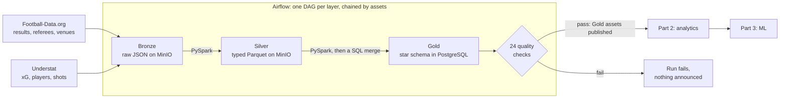

# Football Data Platform — a pipeline built to be re-run and to fail loudly

[](https://github.com/Fabiohhp/football-data-engineering/actions/workflows/ci.yml)

**A daily batch pipeline that loads the big-5 European leagues from two public sources into a
PostgreSQL star schema. Airflow orchestrates it, PySpark transforms it, and a data quality gate
decides whether a night's load is announced downstream. One command starts the whole stack.**

This is Part 1 of a three-part portfolio. This repository builds the warehouse, Part 2 turns it
into answered questions, and Part 3 asks the predictive version of those questions.

| Part | Scope | Repository |
|------|-------|------------|
| **1 — Data Engineering** | **Ingestion, Airflow, Bronze/Silver/Gold, data quality** | **this repository** |
| 2 — Analytics & BI | Metrics layer, analyses, dashboard | [`football-data-analytics`](https://github.com/Fabiohhp/football-data-analytics) |
| 3 — Machine Learning | Match outcome and xG models, evaluation | [`football-data-science`](https://github.com/Fabiohhp/football-data-science) |

**The warehouse has been used, not just built.** Parts 2 and 3 run on a snapshot of it: **3,733
matches, 115,410 player events and 94,034 shots**, the complete 2024/25 and 2025/26 seasons plus
2026/27 to date. Rebuilt from that snapshot, 2024/25's final tables are exact in all five leagues.

---

## What it does



Only Bronze is on a clock, at 06:00 UTC. Each layer publishes the assets it produces, and Airflow
queues the next layer the moment they have all landed. A full run for one date takes about two
minutes: Bronze 1m38s, Silver 17s, Gold 15s, 10 of 10 tasks on the first attempt.

| Concern | Choice | Why |
|---|---|---|
| Orchestration | Airflow 3.1.8, LocalExecutor, three DAGs chained by assets | each layer fails, retries and replays on its own; a broker and workers buy nothing at about 1,300 rows a date |
| Lake | MinIO: raw JSON in Bronze, typed Parquet in Silver | responses are kept as received, so logic can change without re-scraping |
| Processing | PySpark 3.5.3 on a standalone cluster | schemas are declared rather than inferred, and a re-run replaces exactly one date's partition |
| Warehouse | PostgreSQL 16: four dimensions, three facts, SCD Type 2 on players | a stable contract for Parts 2 and 3; transfers are tracked rather than overwritten |
| Loading | Spark lands rows in staging, SQL merges them in one transaction | Spark's JDBC writer only appends or overwrites, and neither is an upsert |
| Quality | 24 SQL checks, ERROR or WARN | only rules the schema cannot express, so a known source quirk does not redden the DAG nightly |

Every DAG, layer, table and check is documented in [`docs/PIPELINE.md`](docs/PIPELINE.md), with
the reasoning and how each was verified.

---

## Why the pipeline can be trusted

The failure that matters here is the quiet one: a night of rows that look fine and are wrong. So
the work went into making those failures loud.

**Re-running changes nothing, and that was measured.** `2025-11-01` went through the whole chain
again after it had already been loaded: 23 matches, 715 player events and 540 shots, unchanged,
with no surrogate keys burned. A failure anywhere in the merge leaves Gold exactly as it was.

**A quality gate that has been seen to fire.** The 24 checks cover what a schema cannot state: an
SCD window that overlaps, a `result` contradicting its own score, goals that do not reconcile
between two fact tables. Each was run against a deliberately corrupted copy of its table inside a
rolled-back transaction, and **21 of 21 detected the violation they claim to catch** (the two venue
checks and the xG coverage check came later and are not in that count). The Gold assets are emitted
by the gate, so an update means "loaded *and* validated".

**The checks caught a real problem.** `dim_players` only opens versions going forward, so a date
loaded out of order attaches a player's goals to a club they had not joined yet. One date loaded
late produced **108 violations**, and an ERROR check stopped it. That is why
[`scripts/backfill.py`](scripts/backfill.py) walks whole seasons one date at a time, in order.

**Airflow's dates are not taken on trust.** Airflow 3 gives a cron run a zero-width data interval,
so `{{ ds }}` on the 06:00 run of day D is D itself, whose matches kick off that evening. That
raises no error: it loads a night of matches with every expected-goals measure null. Bronze asks
for `macros.ds_add(ds, -1)`, and a test renders the template rather than trusting it.

**The two sources check each other.** On `2025-11-01` they join 23 for 23 on date and teams, and
agree on 23 of 23 scorelines, an independent check that team names are being matched to the right
clubs.

**A green CI means the tests ran.** 145 test functions across three jobs: a JVM-free core, the DAGs
on a real Airflow install, and the transforms on real PySpark DataFrames. The last two first assert
that their dependency imports, because `pytest.importorskip` on a degraded install would report
"skipped" and go green having verified nothing.

---

## Scope and limits

- **Batch, on one machine.** It runs in Docker Compose; nothing is deployed to a cloud.
- **Spark is more than this volume needs.** One date is about 1,300 rows. It is here on purpose, to
  show the tooling, and the JVM-free parsers keep the logic testable without it.
- **The big-5 leagues only**, the competitions both sources cover. Football-Data's free tier grants
  more, but they would reach Gold with no xG and no player events.
- **Not in the warehouse:** possession, total passes and tackles. FBref is the only source for them
  and is Cloudflare-blocked, so they are left out rather than shipped as empty columns. Stadium city
  and capacity have no source either, and those two columns stay null.
- **One source is a scraped website.** Understat has no official API and no uptime promise, and in
  November 2026 it stopped answering and then served only a maintenance page. The daily extraction
  then fails loudly and nothing downstream runs. If just one league cannot be read, the others still
  load, the gate reports its matches as a warning, and replaying the date later fills the gap. The
  [recorded date](#reproduce-a-real-date) exercises the rest of the chain without Understat.
- **Rate limits set the pace.** Understat takes about 3 seconds per request and Football-Data allows
  10 calls a minute, so a backfill of whole seasons is slow by design.

---

## Run it

You need Docker. The defaults in `.env.example` work as they are.

```bash
cp .env.example .env
docker compose up -d
docker compose ps       # every service healthy; airflow-init/metadb exit 0
```

The first `up` builds the Airflow and Spark images, about 25 minutes on a clean machine; later
starts are quick.

| Service | URL | Credentials |
|---------|-----|-------------|
| **Airflow UI** | http://localhost:8088 | `AIRFLOW_ADMIN_USER` / `AIRFLOW_ADMIN_PASSWORD` |
| Spark master | http://localhost:8080 | — |
| MinIO console | http://localhost:9001 | `MINIO_ROOT_USER` / `MINIO_ROOT_PASSWORD` |
| PostgreSQL | localhost:5432 | `POSTGRES_USER` / `POSTGRES_PASSWORD` |

### Reproduce a real date

[`data/sample_bronze/`](data/sample_bronze) holds what both sources returned for `2025-11-01`. This
needs no API token and calls neither source. Load it into Bronze and trigger Silver; Gold and the
quality gate follow from the assets:

```bash
docker compose exec -w /opt/football spark-master python -m src.extract.seed_bronze
docker compose exec airflow-scheduler airflow dags trigger silver_football_matches \
  --conf '{"match_date": "2025-11-01"}'
```

It takes about a minute; follow it in the Airflow UI. Gold then holds 23 matches, 715 player events
and 540 shots:

```bash
docker compose exec postgres psql -U football -d football_dw -c "
  SELECT (SELECT count(*) FROM gold.fact_matches) AS matches,
         (SELECT count(*) FROM gold.fact_player_events) AS player_events,
         (SELECT count(*) FROM gold.fact_shots) AS shots"
```

### Run it from the sources

This needs a free [Football-Data.org API token](https://www.football-data.org/client/register) as
`FOOTBALL_DATA_API_TOKEN` in `.env`, and Understat has to be reachable. Triggering Bronze is enough;
the rest follows from the assets:

```bash
docker compose exec airflow-scheduler airflow dags trigger bronze_football_matches \
  --conf '{"match_date": "2025-11-01"}'
```

While the stack is up, the same run starts by itself at 06:00 UTC. Without the token or Understat it goes
red and nothing downstream runs.

### Tests and lint

They need no stack at all:

```bash
python3 -m venv .venv && source .venv/bin/activate
pip install -r requirements.txt
pytest -q
ruff check src tests airflow/dags
```

Replaying one layer, backfilling seasons, running a stage by hand and the full test setup are in
[`docs/PIPELINE.md`](docs/PIPELINE.md).

---

## Repository map

```
airflow/dags/         one DAG per layer, the assets that chain them, connection adapters
src/extract/          Football-Data.org and Understat extractors, raw JSON into Bronze
data/sample_bronze/   one recorded date, loaded by src/extract/seed_bronze.py
src/transform/        parsers.py (pure, JVM-free), bronze_to_silver.py, silver_to_gold.py (PySpark)
src/quality/          the Gold quality suite: checks.py catalogue, run_checks.py runner
src/common/           config, logging, MinIO reader/writer, cross-source team-name normalization
sql/ddl/              star schema and staging tables, applied by Postgres on first start
sql/load/             the Silver to Gold merge statements
sql/airflow/          the Airflow metadata role and database bootstrap
scripts/backfill.py   whole seasons, one date at a time, in order
docker/               the Airflow and Spark images
tests/                unit tests, DAG integrity, Spark transforms
docs/PIPELINE.md      how each layer works, and how it was verified
```

## Data sources

Football data provided by the Football-Data.org API: results, referees and venues from
[Football-Data.org](https://www.football-data.org/). Expected-goals, player and shot data come from
[Understat](https://understat.com/). Each has its own terms of use. The only data committed here is
the [recorded date](data/sample_bronze); everything else stays in the local MinIO and PostgreSQL
volumes.

## Author

Fábio Henrique Peixe ([LinkedIn](https://www.linkedin.com/in/f%C3%A1bio-henrique-peixe/)). Also by
the author: [`football-scouting`](https://github.com/Fabiohhp/football-scouting), a recruitment
back-test on StatsBomb event data.

## License

The code is released under the [MIT License](LICENSE). The data belongs to its providers and is used
under their terms.
